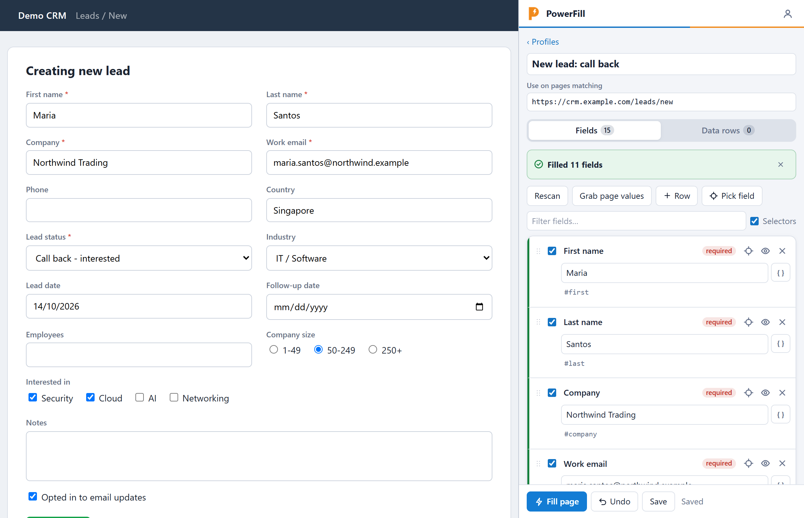
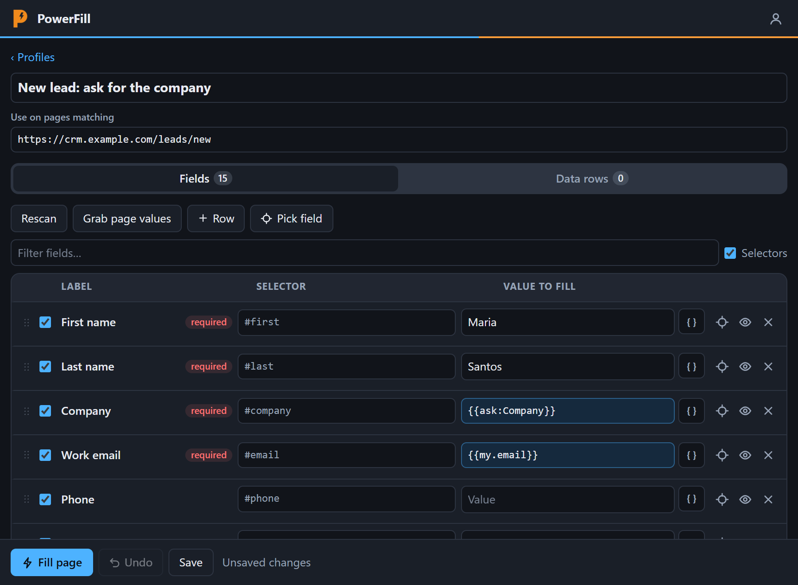
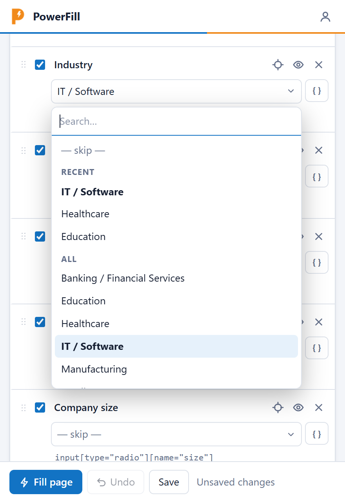
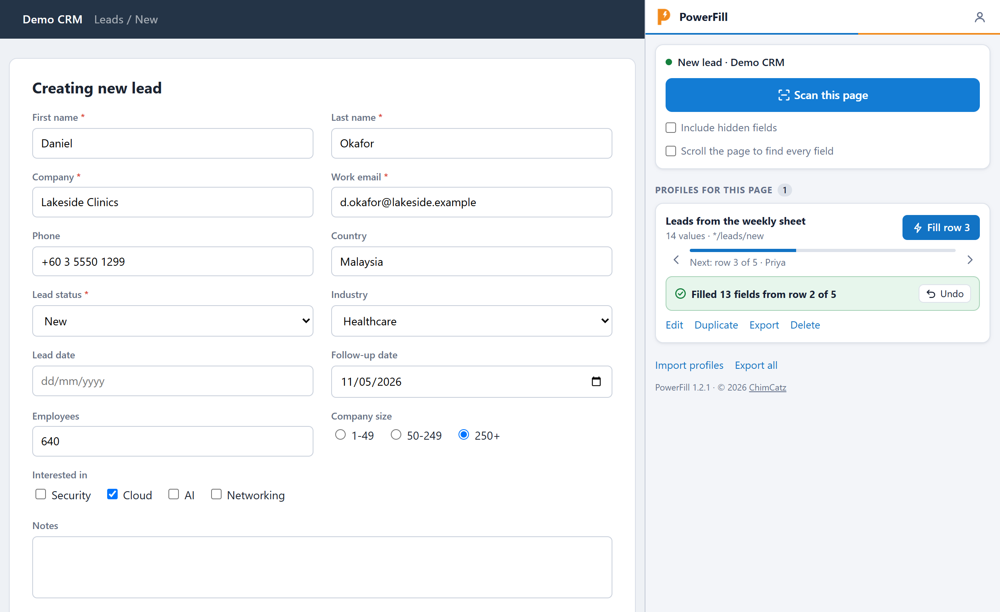
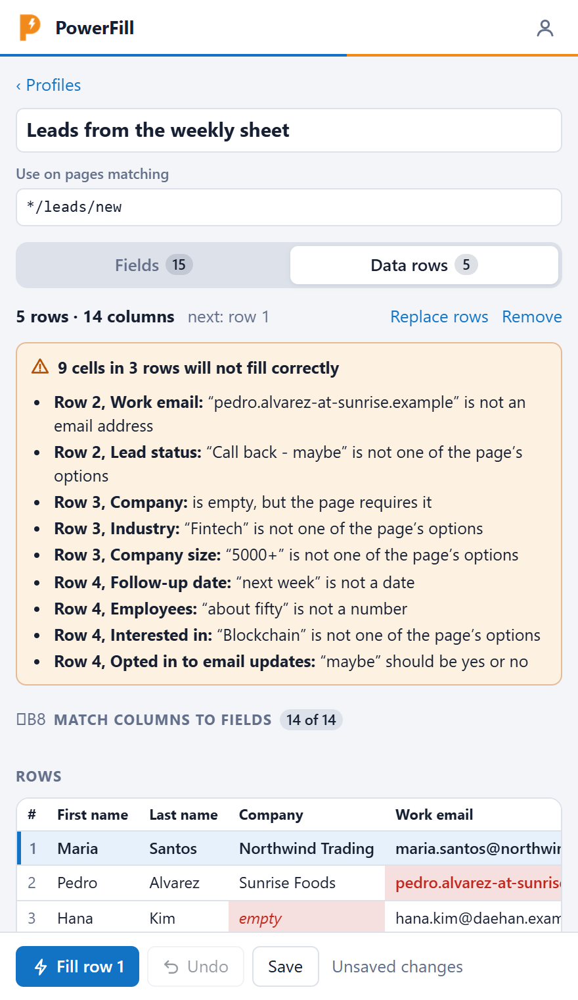

<h1></h1>

**Scan a form once. Fill it in one click, every time after.**

A Chrome extension that reads the fields on any web form, lets you set the values in a simple sheet, and saves them as a profile you can run again and again, or feed row by row from a spreadsheet.

## What it does

- **Scans the page.** Text boxes, picklists, multi-selects, checkboxes, radio groups and rich-text boxes each become one row: **Label**, **Selector**, **Value**.
- **Fills in one click.** Save the sheet as a profile, then press **Fill** or **Alt+Shift+F** whenever you are on that form.
- **Fills from a spreadsheet.** Paste rows from Excel or Google Sheets, match the columns to fields once, and each press of Fill takes the next row.
- **Checks before you save.** After every fill it lists what could not be filled and why, and which required fields are still empty.
- **Undoes a fill.** One click, or **Alt+Shift+U**, puts the page back the way it was.
- **Asks when it has to.** A value can be asked for at fill time, or taken from your own saved details.
- **Makes long picklists quick.** Every picklist has a search box, with the values you chose recently pinned at the top.
- **Finds fields that load late.** An optional scrolling scan reaches fields a page only loads or reveals further down.
- **Works on awkward pages.** Select2 dropdowns, React-style forms, iframes and shadow DOM.
- **Keeps your data local.** Everything stays in your own browser, and PowerFill never submits a form for you.

## Install

PowerFill is not on the Chrome Web Store. You load it from a folder, which takes about a minute.

1. On this page click **Code → Download ZIP**, and unzip it somewhere permanent (for example `Documents\PowerFill`). Chrome runs the extension from that folder, so don't move or delete it afterwards.
2. Open `chrome://extensions`.
3. Turn on **Developer mode** (top right).
4. Click **Load unpacked** and choose the **`extension`** folder inside the one you unzipped.
5. Click the puzzle-piece icon in the toolbar and pin **PowerFill**.

Requires Chrome 116 or newer.

**Updating:** replace the folder's contents with the new version, then click the reload arrow on the PowerFill card in `chrome://extensions`. Your profiles are kept as long as the folder stays in the same place.

## Use

1. Open the form you want to fill and click the PowerFill icon. A panel opens on the right and stays open while you work.
2. Click **Scan this page**.
3. Type the values you want. Leave a value blank to leave that field alone.
4. Click **Fill page** to try it, then **Save**.
5. Next time, open PowerFill and click **Fill** beside the profile, or press **Alt+Shift+F**.

Tips:

- Drag the panel wider and the rows turn into a three-column sheet.
- **Grab page values** copies whatever is typed into the page right now into the sheet. Fill the form by hand once, grab, save.
- **Duplicate** a profile to keep several versions of the same form.
- Untick a row to keep it but skip it. **Filter fields** narrows a long sheet, and unticking **Selectors** hides the selector line.
- Drag the dotted handle at the left of a row to move it, or focus the handle and press the Up and Down arrow keys. Fields are filled in the order of the sheet.

 <em>A wide panel becomes a Label, Selector, Value sheet. It follows Chrome's light or dark theme.</em>

### Picklists: search and recent values

Click a picklist in the sheet and start typing; the list narrows as you type and **Enter** takes the first match. The values you chose most recently for that field are pinned under **Recent**, and they follow the field rather than the profile, so every profile for the same site offers them. If the value you need is not on the list, type it and choose **Use "…"**.

Text boxes suggest what you typed into them before, and a `{{ask:…}}` question about a picklist offers that picklist's options and recent answers as you type.

### When a scan misses fields

Some pages only load or reveal part of a form once you scroll to it, so an ordinary scan cannot see those fields. Tick **Scroll the page to find every field** before scanning (the choice is remembered) and PowerFill scrolls the page from top to bottom first.

While it does that:

- It only scrolls. It never clicks, types or follows a link.
- It stops the moment you click, scroll, type or press **Esc** on the page, and leaves the page where you are.
- **Stop scanning** in the panel ends it too.
- It gives up after 20 seconds, or sooner on a page that keeps growing as it scrolls, such as a feed.
- Otherwise it puts the page back where it was.

If it stops early, it keeps the fields found so far and tells you the rest may be missing.

### Fill from a spreadsheet

For entering a list of records one after another.

1. Open a profile and go to the **Data rows** tab.
2. Copy the cells in Excel or Google Sheets, heading row included, and paste them into the box. **Load a file** takes a `.csv` instead.
3. Columns whose heading matches a field's label are matched for you. Match the rest under **Match columns to fields**.
4. Save. The profile's button now reads **Fill row 1**. Each fill takes one row and moves to the next, so the routine is: fill, check, save the record on the page, fill again.

The arrows beside the progress bar step back or skip a row, and clicking a row in the Data rows tab makes it the next one.

Before you fill anything, the tab checks every matched cell against what the page accepts and lists the ones that will not go in: a picklist value that isn't an option, an email without an @, text where a number or date belongs, a blank where the page requires a value.

Two things to know:

- A blank cell leaves its field alone; it does not empty it. That suits a form that starts blank for each record.
- Rows are kept on your PC only. **Export** leaves them out, so sharing a profile never shares your list.

### Values worked out at fill time

Click **{ }** on a row to insert one, or type it.

| Value | What it does |
| --- | --- |
| `{{ask:Company}}` | Asks you for "Company" every time you fill |
| `{{my.email}}` | Your own saved detail called `email` (see below) |
| `{{Company}}` | The `Company` column of the current data row |
| `{{today}}` | Today's date, in the format the field expects |
| `{{today+7}}`, `{{today-1}}` | A date some days from today |
| `{{today:dd/mm/yyyy}}` | Today's date in a format you choose |
| `{{clear}}` | Empties the field |

Text fields can mix these with typing, such as `Hi {{First name}}`.

**My details** (the person icon, top right) holds values that are yours alone: name, email, phone, anything you add. They are never exported, so a profile that uses `{{my.email}}` fills in each teammate's own address.

### After a fill

- **Green edge** on a row: filled. **Orange**: filled, but the page says the value is wrong (and why). **Red**: not filled, with the reason.
- The report names every field that needs a look. Click a name to see the field on the page.
- **Required by the page but still empty** lists what will stop the page from saving.
- **Undo** restores every field the fill changed. It works until the page reloads.

### Fixing a selector

If a field is not found, or the scan missed one:

- Click the crosshair on the row (or **Pick field** for a new row), then click the field on the page.
- Or right-click the field, choose **Inspect**, right-click the highlighted line in DevTools, choose **Copy**, and paste into the Selector box. **Copy selector**, **Copy JS path**, **Copy XPath**, **Copy full XPath**, **Copy element** and **Copy outerHTML** all work.
- Or type a plain id or name, such as `company`.

The eye button shows which field a selector points at.

### Which pages a profile appears on

Each profile has a **Use on pages matching** pattern, filled in for you when you scan.

- `*` matches anything: `https://crm.example.com/leads/*/edit` covers every lead.
- Any `name=value` after the `?` must be in the page's address: `https://crm.example.com/index.php?module=Leads&view=Edit` matches that screen for any record.

Profiles that don't match the current page are still there under **Other profiles**.

### Sharing profiles

**Export** (one profile) or **Export all** saves a `.json` file. A colleague clicks **Import profiles** and picks it. Importing a newer export of the same profile replaces the old one and keeps any data rows they had loaded.

### Keyboard shortcuts

| Keys | What happens |
| --- | --- |
| **Alt+Shift+F** | Fills with the matching profile you used most recently. Any `{{ask:…}}` question appears on the page itself. |
| **Alt+Shift+U** | Undoes the last fill |

The badge on the icon shows how many fields were filled. `!` means something needs a look, `?` means no profile matches the page, and `END` means the data rows are used up. Change the keys at `chrome://extensions/shortcuts`.

## Try it without touching a real system

The `examples` folder has a made-up lead form and two spreadsheets for it:

- `demo-form.html` is the form in the screenshots. To use PowerFill on a file opened from disk, turn on **Allow access to file URLs** for PowerFill in `chrome://extensions` → **Details**.
- `leads.csv` has five clean rows.
- `leads-with-mistakes.csv` has the same columns with deliberate errors, to show what the checks catch.

## Good to know

- Values are stored as plain text, and exported files contain them. Don't save real passwords in a profile.
- Hidden fields are skipped by default, because on public sites they are often spam traps. Tick **Include hidden fields** before scanning if a form needs them.
- PowerFill can't fill file uploads or CAPTCHAs, and can't run on Chrome's own pages (`chrome://`, the Web Store).
- Chrome shows a "read and change all your data on all websites" notice when you load it. PowerFill needs that to read and fill forms on whichever site you use it on; it does nothing on a page until you press a button in the panel or use a shortcut.

## Project layout

Plain JavaScript, no dependencies and no build step. Edit a file, then click the reload arrow on the PowerFill card in `chrome://extensions`.

| Path | What it is |
| --- | --- |
| `extension/manifest.json` | Extension manifest (Manifest V3) |
| `extension/content/engine.js` | Runs in the page: scanning, selector building, filling, undo, the picker |
| `extension/panel/` | The side panel: profile list, field sheet, data rows, My details |
| `extension/lib/` | Storage, URL matching, `{{token}}` handling, spreadsheet reading, and the code that runs a fill |
| `extension/background.js` | Opens the panel from the toolbar and handles the keyboard shortcuts |
| `examples/` | The demo form and sample spreadsheets |
| `tests/` | End-to-end tests that drive the extension in headless Chrome |

To run the tests: `cd tests`, `npm install`, `npm test`. They need Chrome installed; set the `CHROME` environment variable if it is not in the default Windows location. `npm run screenshots` regenerates the pictures in `docs/`.

## License

Copyright © 2026 [ChimCatz](https://github.com/ChimCatz). Released under the [MIT License](LICENSE).
