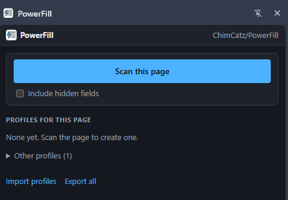

# PowerFill

**Scan a form once. Fill it in one click, every time after.**

A Chrome extension that reads the fields on any web form, lets you set the values in a simple sheet, and saves them as a profile you can run again and again.

## What it does

- **Scans the page.** Text boxes, picklists, multi-selects, checkboxes, radio groups and rich-text boxes each become one row: **Label**, **Selector**, **Value**.
- **Fills in one click.** Save the sheet as a profile, then press **Fill** or **Alt+Shift+F** whenever you are on that form.
- **Understands the field.** Picklists offer the page's own options, checkbox groups become a checklist, and dates follow the format the field expects.
- **Lets you fix a selector three ways.** Click the field on the page, paste anything from DevTools' *Copy* menu, or type an id or name.
- **Works on awkward pages.** Select2 dropdowns, React-style forms, iframes and shadow DOM.
- **Shares with a team.** Export a profile to a `.json` file; a colleague imports it.
- **Keeps your data local.** Profiles live in your own browser. Nothing is sent anywhere, and PowerFill never submits a form for you.

## Install

PowerFill is not on the Chrome Web Store. You load it from a folder, which takes about a minute.

1. On this page click **Code → Download ZIP**, and unzip it somewhere permanent (for example `Documents\PowerFill`). Chrome runs the extension from that folder, so don't move or delete it afterwards.
2. Open `chrome://extensions`.
3. Turn on **Developer mode** (top right).
4. Click **Load unpacked** and choose the **`extension`** folder inside the one you unzipped.
5. Click the puzzle-piece icon in the toolbar and pin **PowerFill**.

Requires Chrome 116 or newer.

**Updating:** replace the folder's contents with the new version, then click the reload arrow on the PowerFill card in `chrome://extensions`. Your profiles are kept as long as the folder stays in the same place.

## Use

1. Open the form you want to fill and click the PowerFill icon. A panel opens on the right and stays open while you work.
2. Click **Scan this page**.
3. Type the values you want. Leave a value blank to leave that field alone.
4. Click **Fill page** to try it, then **Save profile**.
5. Next time, open PowerFill and click **Fill** beside the profile, or press **Alt+Shift+F**.

 <em>The panel follows Chrome's light or dark theme.</em>

Tips:

- Drag the panel wider and the rows turn into a three-column sheet.
- **Grab page values** copies whatever is typed into the page right now into the sheet. Fill the form by hand once, grab, save.
- **Duplicate** a profile to keep several versions of the same form.
- Untick a row to keep it but skip it. **Filter fields** narrows a long sheet.
- A green edge on a row means it was filled. An orange edge comes with the reason it was not.

### Fixing a selector

If a field is not found, or the scan missed one:

- Click the crosshair on the row (or **Pick field** for a new row), then click the field on the page.
- Or right-click the field, choose **Inspect**, right-click the highlighted line in DevTools, choose **Copy**, and paste into the Selector box. **Copy selector**, **Copy JS path**, **Copy XPath**, **Copy full XPath**, **Copy element** and **Copy outerHTML** all work.
- Or type a plain id or name, such as `company`.

The eye button shows which field a selector points at.

### Special values

| Value | What it does |
| --- | --- |
| `{{today}}` | Today's date, in the format the field expects |
| `{{today+7}}`, `{{today-1}}` | A date some days from today |
| `{{today:dd/mm/yyyy}}` | Today's date in a format you choose |
| `{{clear}}` | Empties the field |

### Which pages a profile appears on

Each profile has a **Use on pages matching** pattern, filled in for you when you scan.

- `*` matches anything: `https://crm.example.com/leads/*/edit` covers every lead.
- Any `name=value` after the `?` must be in the page's address: `https://crm.example.com/index.php?module=Leads&view=Edit` matches that screen for any record.

Profiles that don't match the current page are still there under **Other profiles**.

### Sharing profiles

**Export** (one profile) or **Export all** saves a `.json` file. A colleague clicks **Import profiles** and picks it. Importing a newer export of the same profile replaces the old one.

## Good to know

- Values are stored as plain text, and exported files contain them. Don't save real passwords in a profile.
- Hidden fields are skipped by default, because on public sites they are often spam traps. Tick **Include hidden fields** before scanning if a form needs them.
- PowerFill can't fill file uploads or CAPTCHAs, and can't run on Chrome's own pages (`chrome://`, the Web Store).
- **Alt+Shift+F** uses the matching profile you used most recently. The number on the icon is how many fields were filled; `!` means some were not, and `?` means no profile matches the page. Change the key at `chrome://extensions/shortcuts`.
- Chrome shows a "read and change all your data on all websites" notice when you load it. PowerFill needs that to read and fill forms on whichever site you use it on; it does nothing on a page until you press a button in the panel or use the shortcut.

## Project layout

Plain JavaScript, no dependencies and no build step. Edit a file, then click the reload arrow on the PowerFill card in `chrome://extensions`.

| Path | What it is |
| --- | --- |
| `extension/manifest.json` | Extension manifest (Manifest V3) |
| `extension/content/engine.js` | Runs in the page: scanning, selector building, filling, the picker |
| `extension/panel/` | The side panel: profile list and the field sheet |
| `extension/lib/` | Profile storage, URL matching, DevTools paste handling, and the bridge to the page |
| `extension/background.js` | Opens the panel from the toolbar and handles the keyboard shortcut |

## License

[MIT](LICENSE)
